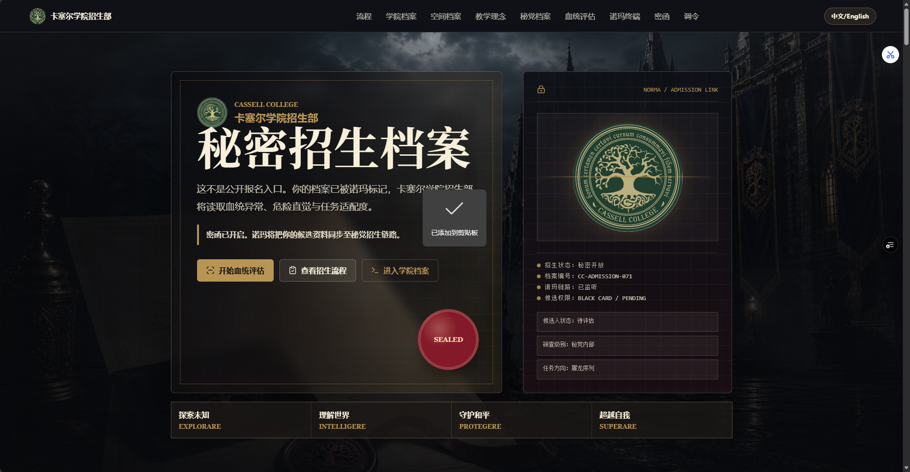
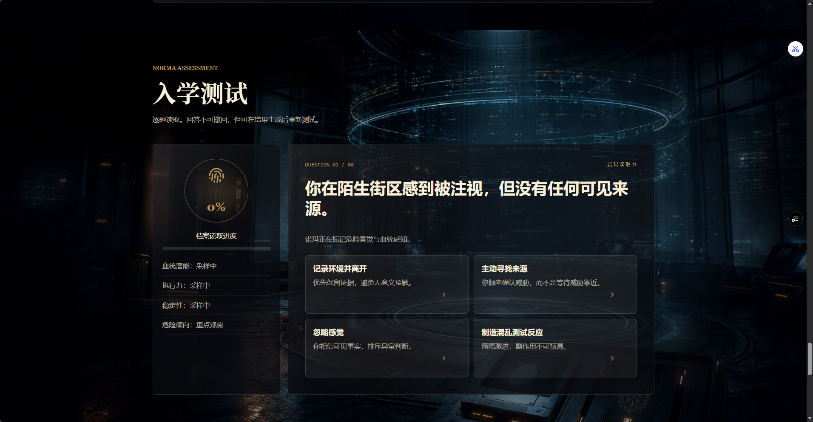
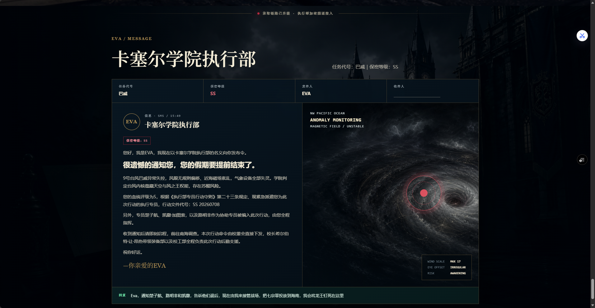

# 龙族 · 卡塞尔学院秘密招生档案

以《龙族》世界观为灵感的沉浸式前端交互项目。打开来自卡塞尔学院的密函，浏览学院与秘党档案，完成诺玛血统评估，获取属于你的候选人评级与录取密函。

[在线体验](https://dragon-raja.vercel.app/) · [项目仓库](https://github.com/Al-478/Dragon-Raja)



## 项目特色

- **密函开启体验**：封存信函、开启动画与主题音频，营造秘密招生的代入感。
- **学院与空间档案**：展示学院课程、人物资料、入学动线、诺玛中枢、冰窖、装备部与校长办公室等内容。
- **秘党与言灵档案**：浏览组织资料、执行简报、装备记录、言灵排行与学院守则。
- **诺玛血统评估**：通过情境问答计算血统、执行、稳定性与危险倾向，生成 S / A / B / C 评级、建议部门、任务适配度及风险提示，支持重新测试。
- **录取密函**：完成评估后查看密函，切换中英文版本，下载 PNG 图片或调用浏览器打印。
- **执行部调令**：以 EVA 加密信息与任务看板的形式展示“巴威”任务。
- **双语内容与响应式布局**：支持主要站点内容中英文切换，并适配不同屏幕尺寸。

本项目为主题交互原型，所有测试结果、档案编号和招生流程均为模拟内容，不构成真实招生入口。评估在浏览器中计算；当前代码未接入后端服务或数据库，刷新页面后测试进度会重置。下载的密函为仓库内预制图片，文件名使用评估生成的录取编号。

## 页面预览

### 诺玛血统评估

通过情境问答完成入学测试，获取候选人评级与任务适配建议。



### 中文录取密函

完成评估后可查看中英文密函，并下载图片或打印留存。


### 执行部调令

EVA 发布“巴威”任务，呈现任务信息与台风监测画面。



## 技术栈

| 技术 | 用途 |
| --- | --- |
| React 19 | 页面组件与交互状态 |
| TypeScript 5.7 | 类型检查 |
| Vite 6 | 本地开发与生产构建 |
| Lucide React | 界面图标 |
| CSS | 页面样式、动画与响应式布局 |

## 本地运行

需要安装 **Node.js 20 或更高版本**、npm 和 Git。

```bash
git clone https://github.com/Al-478/Dragon-Raja.git
cd Dragon-Raja
npm ci
npm run dev
```

打开终端输出的本地地址，默认通常为 `http://127.0.0.1:5173`；若端口被占用，以实际输出为准。

当前版本无需配置环境变量或 API 密钥。

## 构建与预览

```bash
# 执行 TypeScript 检查并生成生产文件
npm run build

# 本地预览构建结果
npm run preview
```

构建产物位于 `dist/`，可部署到支持静态网站的托管平台。`preview` 用于本地检查构建效果。

## 目录结构

```text
Dragon-Raja/
├── docs/screenshots/       # README 页面截图
├── public/                 # 图片、音频、密函及其他静态素材
│   ├── audio/              # 主题音频
│   ├── materials/          # 校园、人物、言灵等视觉素材
│   └── notice/             # 中英文密函图片
├── src/
│   ├── App.tsx             # 页面内容、问答评分与交互逻辑
│   ├── main.tsx            # React 入口
│   └── styles.css          # 页面样式与响应式布局
├── index.html              # HTML 入口
├── package.json            # 依赖、脚本与 Node.js 版本要求
├── package-lock.json       # 依赖锁定文件
├── tsconfig.json           # TypeScript 配置
└── vite.config.ts          # Vite 配置与资源基础路径
```

## 部署到 Vercel

在 Vercel 中导入本仓库，使用以下项目配置：

| 配置项 | 值 |
| --- | --- |
| 框架预设 | Vite |
| 根目录 | 仓库根目录 |
| 安装命令 | `npm ci` |
| 构建命令 | `npm run build` |
| 输出目录 | `dist` |

项目的 `vite.config.ts` 当前设置 `base: "/"`，适用于域名根路径部署。若部署到子路径，需要同步调整该配置，并检查静态资源的访问路径。

## 内容维护

- **修改文案与问答**：编辑 `src/App.tsx` 中的中英文文案、问题列表和 `makeResult` 评分逻辑。
- **调整视觉效果**：编辑 `src/styles.css`。
- **替换图片或音频**：更新 `public/` 中的对应文件；修改文件名时同步更新 `src/App.tsx` 中的引用。
- **更新密函**：替换 `public/notice/` 中的中英文图片，并检查预览、下载与打印效果。

提交修改前，可运行 `npm run build` 检查类型与打包结果，并手动走一遍“开启密函 → 完成评估 → 查看结果 → 下载或打印”的交互流程。
